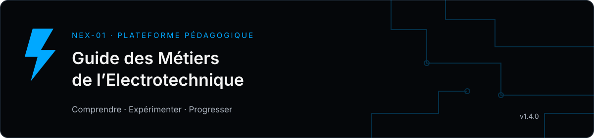

<div align="center">



**Une plateforme pédagogique hors ligne pour explorer les métiers et les fondamentaux de l’électrotechnique.**

Français · العربية · English | Windows · Android 9+ | Version 1.4.0

[العربية](docs/README.ar.md) · [English](docs/README.en.md) · [Installation et construction](docs/BUILD.md) · [Notes de version](docs/CHANGELOG-1.4.0.md)

[Télécharger pour Android](https://github.com/soufiane-nex-01/guide-electrotechnique/releases/download/v1.4.0/Guide-Electrotechnique-Android.apk) · [Télécharger pour Windows](https://github.com/soufiane-nex-01/guide-electrotechnique/releases/download/v1.4.0/Guide-Electrotechnique.zip) · [Tous les fichiers de la version 1.4.0](https://github.com/soufiane-nex-01/guide-electrotechnique/releases/tag/v1.4.0)

</div>

## Le projet

**Guide des Métiers de l’Electrotechnique** est une application éducative portée par **NEX-01**, créée pour rendre les domaines de l’électricité accessibles au grand public et accompagner une progression structurée. Elle associe une bibliothèque historique conservée, des explications traduites, des parcours, des exercices corrigés et des simulations interactives.

La langue de référence est le français. L’arabe bénéficie d’une interface RTL, et l’anglais est également disponible. Le thème clair ou sombre se choisit dans **Préférences**. L’interface utilise des surfaces sobres, un bleu électrique et des dessins techniques légers.

## Contenu de la version 1.4.0

| Fonction | Contenu |
| --- | --- |
| Bibliothèque | 615 entrées, 89 chapitres, 7 domaines |
| Activités reconstruites | 41 activités en HTML, SVG et JavaScript : 39 issues de l’archive disponible et 2 alternatives éducatives à des fichiers illisibles |
| Laboratoire | 7 expériences : diviseur de tension et défauts, Wheatstone, RC, puissance en alternatif, auto-maintien, boucle 4–20 mA et PWM/buck idéal |
| Parcours | 6 parcours, 36 leçons et 72 questions corrigées |
| Évaluation pratique | Sessions de 12 questions variables, explications et historique local |
| Lexique | 48 termes français avec traduction du terme et de sa définition en arabe ou anglais |
| Conservation | 769 fichiers SWF originaux et 8 PDF ; lecture Flash via Ruffle à la demande |
| Relecture historique | 59 notes dans 47 fiches, sans modifier le texte français original |

Recherche, filtres, favoris, reprise de lecture et progression restent disponibles hors ligne. Les PDF disposent d’un lecteur intégré sur Android. Les liens vers les références externes ouvrent le navigateur.

## Utilisation

- **Android :** installer le fichier `Guide-Electrotechnique-Android.apk` de la livraison. Android 9 minimum, avec une WebView récente. Une mise à jour portant la même signature conserve les données locales si l’application n’est pas désinstallée.
- **Windows :** extraire tout le fichier `Guide-Electrotechnique.zip`, puis ouvrir `Guide-Electrotechnique.exe`. Le dossier `app` doit rester à côté du lanceur. Celui-ci ouvre un serveur limité à `127.0.0.1:8876` et peut être arrêté depuis la zone de notification.
- **Depuis les sources :** suivre [les instructions de construction](docs/BUILD.md). Aucun compte n’est nécessaire pour utiliser l’application.

Les données personnelles de progression sont stockées sur l’appareil. L’APK ne demande aucune permission Internet. Effacer les données de l’application ou du navigateur efface aussi cette progression.

## Architecture et performances

L’interface est écrite en **HTML, CSS et JavaScript**, sans framework de rendu. Le conteneur Android utilise **Java et Android WebView**, le lanceur Windows **C# et .NET Framework**. Le dépôt contient les variantes Web propres à chaque plateforme ; elles ne doivent pas être remplacées l’une par l’autre sans conserver leurs adaptations.

Les nouvelles simulations chargent uniquement leurs modules natifs, sans Ruffle. Les données de lecture sont chargées à la demande, avec un cache limité. Les calculs et dessins SVG réagissent aux commandes ; ils n’utilisent ni shaders, ni vidéos d’arrière-plan, ni boucle d’animation permanente. Les modèles de traduction utilisés pendant la préparation ne sont pas embarqués.

```text
desktop/app/          Interface et contenu pour ordinateur
desktop/Source/       Lanceur local C#
android/source/       Conteneur Java, ressources et version Web Android
docs/                 Installation, design, références et vérifications
tests/                Contrôles numériques reproductibles avec Node.js
scripts/              Compilation du lanceur Windows
```

## Vérifications et limites

La livraison a passé **642 contrôles et groupes de scénarios programmatiques**, et ses **3 320 actifs Web Android** ont été comparés aux sources. Le certificat, l’alignement et l’intégrité de l’APK ont été vérifiés. Les contrôles DOM utilisent happy-dom et ne remplacent pas un essai de WebView réelle. Voir [le rapport détaillé](docs/VERIFICATION.md).

Cette version n’a pas été validée sur téléphone physique ou émulateur ; les performances sur l’itel S18 et le contrôle visuel complet restent à confirmer. Les traductions des 615 fiches sont assistées et partiellement relues. Les 36 leçons et 72 questions ajoutées ont été revues en arabe et en anglais. Les dessins historiques non reconstruits et les PDF restent dans leur langue d’origine. Quatre références sont absentes de l’archive et deux SWF sont illisibles ; ces limites sont signalées dans l’application.

Les simulations sont pédagogiques et leurs modèles sont simplifiés. Les résultats d’un quiz ne constituent pas une habilitation électrique. Les notes historiques et les courbes anciennes ne remplacent pas les prescriptions actuelles ni la documentation du fabricant.

## Sources et attribution

La partie historique est attribuée à **Philippe Juguet / POS Industry (2004–2005)**. La modernisation, les parcours complémentaires et les nouvelles activités sont présentés sous l’identité **NEX-01**. Les ajouts s’appuient notamment sur [Sitelec](https://sitelec.org/index.php), [INRS](https://www.inrs.fr/risques/electriques/prevention-risque-electrique.html), [OpenStax](https://openstax.org/), [Modbus Organization](https://www.modbus.org/modbus-specifications), Texas Instruments et NI ; les références précises accompagnent les leçons.

Les droits des contenus historiques et des composants tiers restent attachés à leurs auteurs. Ce dépôt ne leur attribue pas une nouvelle licence globale. Lire [ATTRIBUTION.md](ATTRIBUTION.md) avant de réutiliser ou redistribuer des éléments.

## Contribuer

Pour signaler un problème, indiquer la version, la plateforme, la langue, le titre de la fiche et les étapes de reproduction. Pour une correction technique ou une traduction, joindre une référence spécialisée. Ne joindre aucune clé de signature, mot de passe ou donnée personnelle. Les modifications doivent conserver la langue française de référence, les attributions et le fonctionnement hors ligne.
